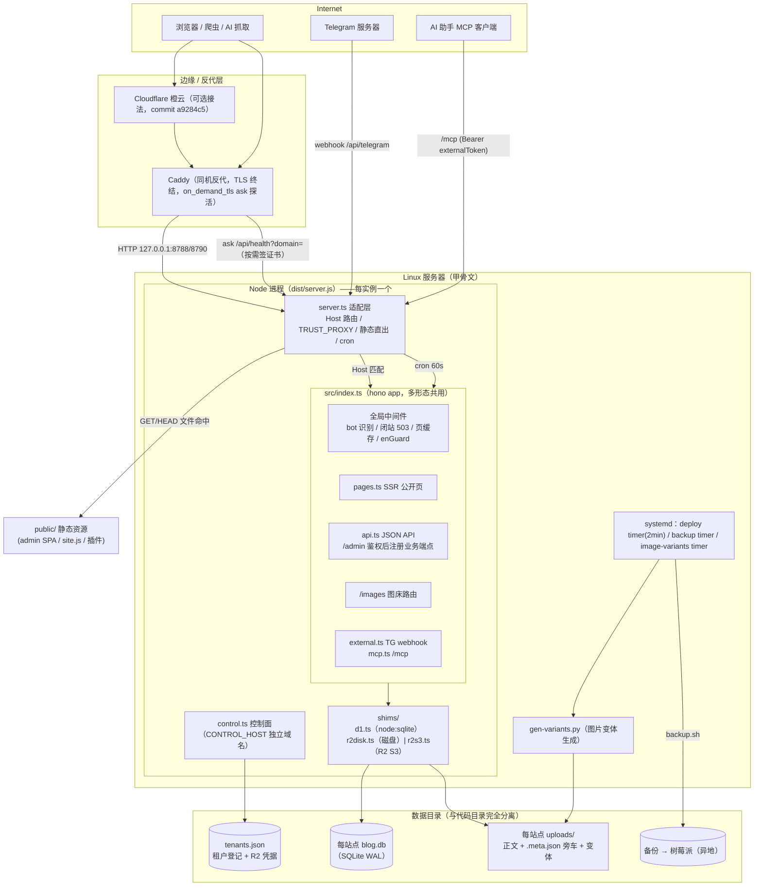
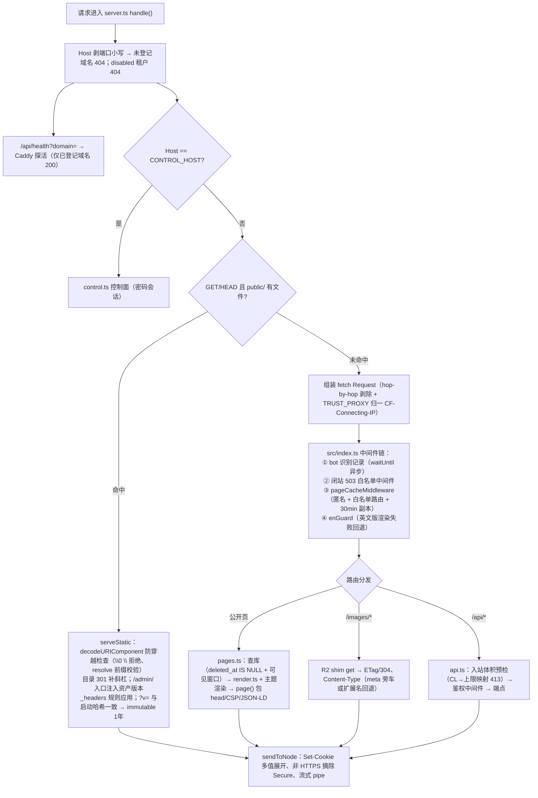
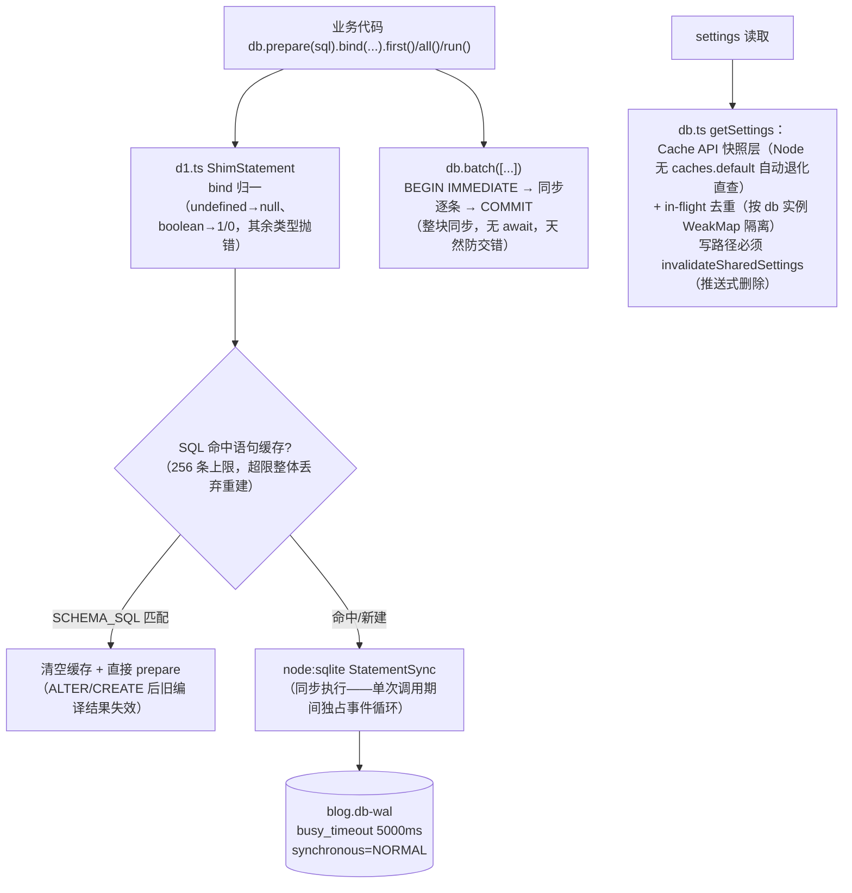
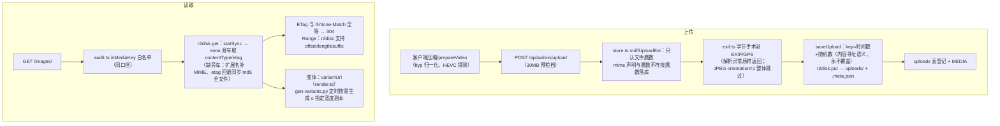
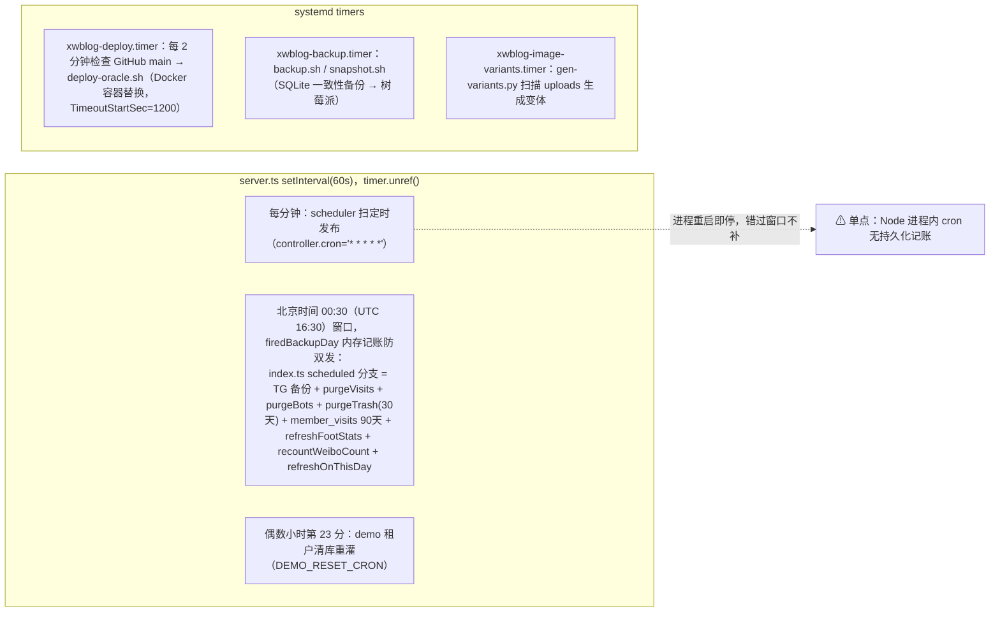
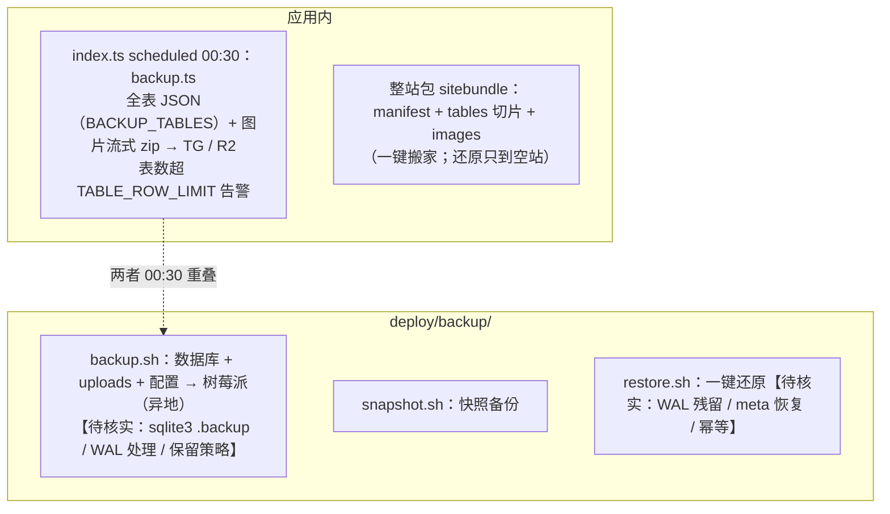
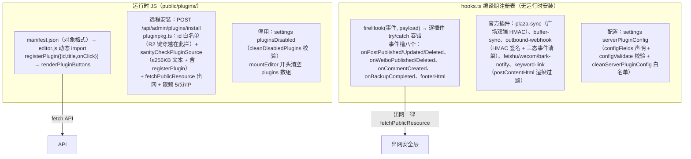
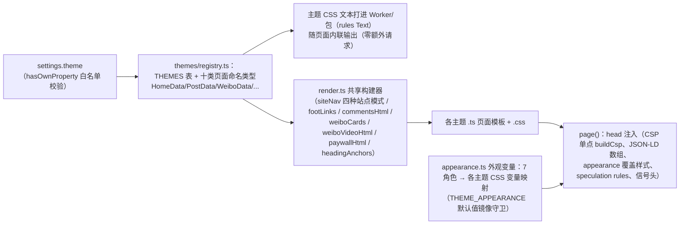
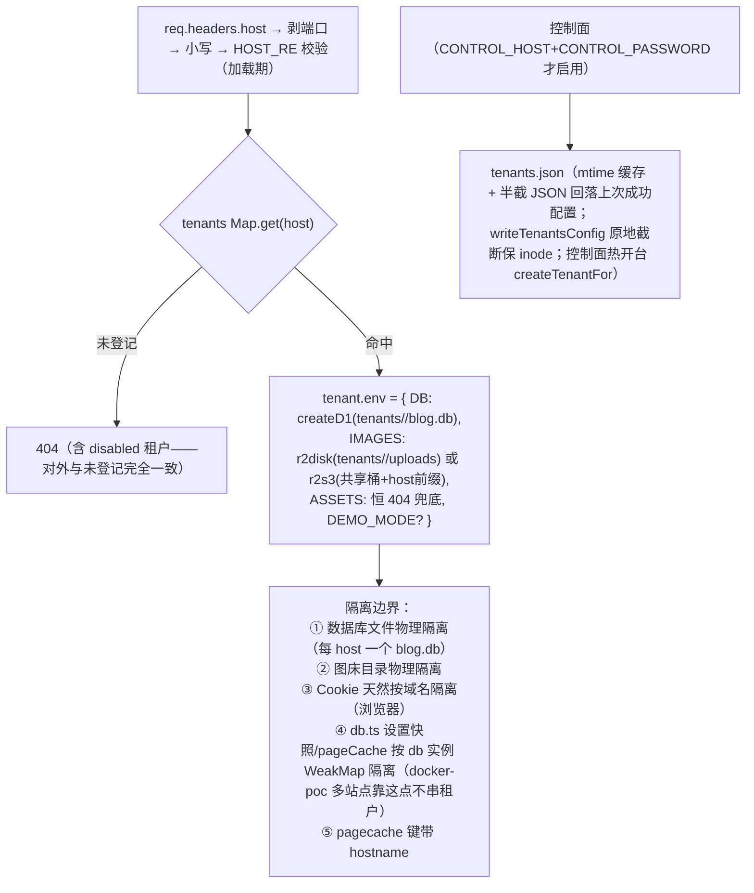

# ARCHITECTURE_REPORT — xwblog 全项目架构摸底报告

> 阶段 A 产出（2026-11-04）。基线：commit `864c73f`（main，与 origin 同步）；`npm run typecheck` 通过；`npm test` **1006/1006 全绿**。
> 本报告只做「系统是什么、怎么跑」，问题清单与修复方案见 `AUDIT_REPORT.md` / `REMEDIATION_PLAN.md`。标注【待核实】的条目由专项审计员交叉确认后回填。

---

## 0. 摘要与关键事实

| 项 | 事实 | 证据 |
| --- | --- | --- |
| 业务代码 | `src/` 65 个 TS 文件 ≈ 25,500 行（hono 单依赖），与 Cloudflare Workers 形态共用同一份代码 | `wc -l src/*.ts` |
| 生产入口 | **`docker-poc/server.ts` → 编译产物 `dist/server.js`**：Node `http.createServer` 单进程，按 Host 头做多站点路由，直接 import `src/index.ts` 的 `fetch` + `scheduled`（业务代码零改动） | docker-poc/server.ts:14-33,502 |
| 数据库 | 每站点独立 SQLite 文件（`node:sqlite` DatabaseSync），WAL + busy_timeout=5000 + synchronous=NORMAL + foreign_keys=ON + 语句缓存（256 条） | docker-poc/shims/d1.ts:92-111 |
| 文件存储 | 每站点独立磁盘目录（R2 API 适配到磁盘：正文文件 + `.meta.json` 旁车存 contentType/etag）；备选共享 R2（S3 SigV4 自实现） | docker-poc/shims/r2disk.ts:148-233 |
| 静态资源 | server.ts 直出 `public/`（对齐 wrangler assets 行为：文件命中即返、其余进应用；解析 `public/_headers` 注入安全头） | docker-poc/server.ts:293-354 |
| 定时任务 | server.ts 内 `setInterval(60s)` 仿真 wrangler cron：每分钟逐站点调 `xwblog.scheduled`（定时发布）；北京时间 00:30 备份/清理窗口；demo 站每 2h 重置 | docker-poc/server.ts:507-548 |
| 主题 | **8 套**（wechat 默认 / paper / midnight / minimal / journal / bitcoin / rednote / **news**）+ registry 命名类型。⚠ 任务书口径「七套」已过时 | src/themes/ 目录 |
| 测试 | 1006 个用例（tsx --test，Node 原生 test runner），CI 强制；smoke 为 wrangler dev 逐路由断言 | npm test 实测 |
| 部署自动化 | systemd timer 每 2 分钟轮询 GitHub main → `scripts/deploy-oracle.sh`（**Docker 容器替换**：ARM 原生构建 `docker build -f docker-poc/Dockerfile`，镜像按 commit 打 tag，健康检查失败自动回滚）；双实例 `xwblog-next`(127.0.0.1:8788，blog.xiaowuleyi.com) / `btchao-blog`(127.0.0.1:8790，blog.btchao.com)，数据目录分离（`/opt/xwblog-data`、`/opt/btchao-blog/data`） | deploy/systemd/xwblog-deploy.{service,timer}、docs/DEPLOY-ORACLE.md（首次接入 2026-11-03，机器 167.234.216.40，Ubuntu 20.04 / aarch64 Ampere A1） |
| ⚠ 口径冲突 | **任务书说生产「不使用 Docker」，但仓库自 2026-11-03 起的部署文档与自动化都是 Docker 容器替换流程**（`Requires=docker.service`）。两种形态跑的都是同一份 `dist/server.js` + 同一套数据目录约定，软件栈确为 Node.js（node:26-alpine）+ SQLite + 本地磁盘卷；容器只改变进程监督与回滚方式，不改变代码审计基准。**需站长确认生产实际形态**（不影响本次代码审计结论的有效性）；若生产确为裸 systemd Node 跑 `dist/server.js`，则部署自动化部分的问题降级为「备用通道」 | deploy/systemd/xwblog-deploy.service、scripts/deploy-oracle.sh:267、docs/DEPLOY-ORACLE.md |
| 历史路线 | Cloudflare Workers + D1 + R2 形态保留可运行（wrangler.jsonc / demo 站）；审计按任务书要求不作为生产基准 | wrangler.jsonc |

---

## 1. 三种运行形态的区分

```
A. 生产形态（审计基准）    Node.js http server（dist/server.js，node:26-alpine 镜像内为裸 node 进程）
                          ├─ 数据：node:sqlite 单文件库（每站点一个，WAL）
                          └─ 文件：本地磁盘 uploads/ 目录
                          进程监督：仓库文档/自动化 = Docker 容器替换（docs/DEPLOY-ORACLE.md，2026-11-03 起）；
                                   任务书口径 = 裸 systemd Node【两者代码路径完全相同，需站长确认】

B. Cloudflare Workers 形态（保留可运行）  wrangler.jsonc → src/index.ts
                          ├─ 数据：D1（xwblog-db）
                          └─ 文件：R2（xwblog-images）
                          部署：Workers Builds（Git 集成）或 wrangler deploy

C. 演示站形态             独立仓库 bloghao-demo（本仓库快照 + DEMO_MODE 门控）
                          Docker 容器 127.0.0.1:8786，Caddy 反代 demo.bloghao.com
```

**关键设计**：`src/` 业务代码对三种形态零感知——Workers 专有 API 面（D1/R2/Cache API/cron/waitUntil）全部由适配层补齐：
- `docker-poc/shims/d1.ts`：D1 → node:sqlite（prepare/bind/first/all/run/batch/exec/meta.changes/last_row_id；batch 用 BEGIN IMMEDIATE 同步事务）
- `docker-poc/shims/r2disk.ts`：R2 → 磁盘（put 流式落盘、get 支持 Range、list 全树遍历、etag 存旁车文件）
- `docker-poc/shims/r2s3.ts`：R2 → S3 兼容端点（自实现 SigV4，含 AWS 官方向量自检 `--selftest`）
- `docker-poc/server.ts`：waitUntil 仿真、TRUST_PROXY 访客 IP 档位、_headers 镜像、cron 仿真
- `src/db.ts`/`src/pagecache.ts`：Cache API（caches.default）缺失时自动退化为直查直渲染（无需 shim）

---

## 2. 整体系统架构（生产形态）



---

## 3. 请求处理流程（SSR 页面）



## 4. 认证与权限流程

```mermaid
flowchart TB
    subgraph 管理员
        L["POST /api/auth/login<br/>密码 PBKDF2(salt:hash) → sessions 落 SHA-256(tokenHash)<br/>needsTotp 预显 → verifyTotp（±1 窗口恒时比较）<br/>失败 → alertLoginFailure（TG，10min/1条）"]
        S["Cookie bloghao_session（HttpOnly；Secure 由 isSecureRequest/resolveScheme 决定）"]
        AU["api.use('/admin/*') 鉴权中间件<br/>（**注册顺序即安全边界**：业务端点必须在其后）<br/>role: admin 全量 / author 白名单 AUTHOR_ALLOWED_PREFIXES"]
    end
    subgraph 会员
        MR["POST /api/member/register（Turnstile fail-closed + 邀请码）<br/>ML["POST /api/member/login"]]
        MS["Cookie xw_member_session（独立于管理员）"]
        MV["getMemberUser：membersEnabled 门控 + status!=banned<br/>effectiveTier 读侧即时降级（过期不靠 cron）"]
    end
    subgraph 机器
        TK["externalToken（Bearer/X-Auth-Token，safeEqual）<br/>→ /api/external/*、/api/telegram、POST /mcp"]
        PP["文章密码：POST /post/:slug/unlock（表单 303）<br/>令牌 postId.exp.hmac(key=该文 password_hash)"]
    end
    L --> S --> AU
    MR --> MS --> MV
    TK
    PP
```

## 5. SQLite 数据访问流程



**表清单（22 张）**：users / sessions / members / member_sessions / member_points_log / member_visits / member_likes / invite_codes / invite_uses / posts / comments / categories / post_categories / weibo / tags / uploads / friend_links / pages / tg_buffer / settings / visit_log / bot_log。
**软删三表**：posts / weibo / pages（deleted_at 毫秒时间戳，回收站 30 天）。
**schema 双表达**：schema.sql（建表 + FTS 触发器除外）与 db.ts SCHEMA_COLUMNS/SCHEMA_TABLES/SCHEMA_INDEXES 两处必须同步（ensureSchema 先 ALTER 后 CREATE 兜底老库）。

## 6. 本地文件上传与读取流程



## 7. 定时任务流程（生产形态）



## 8. 备份与恢复流程



## 9. 插件执行流程



## 10. 主题注册与渲染流程



## 11. 多租户识别及隔离流程



---

## 12. 模块清单

图例：鉴权=涉及身份认证｜敏感=涉及敏感数据/口令｜测试=有自动化测试守卫。风险注记只写「结构性」风险，具体问题归 AUDIT_REPORT。

### 12.1 入口与适配层

| 模块 | 功能 | 行数 | 表 | 鉴权 | 敏感 | 测试 | 风险注记 |
| --- | --- | --- | --- | --- | --- | --- | --- |
| `src/index.ts` | Workers/Node 共用入口：中间件链（bot 识别/闭站/页缓存/enGuard）、路由挂载、scheduled cron 分发 | 494 | – | ✓ | – | smoke | cron 分支全集中于此 |
| `docker-poc/server.ts` | 生产入口：Host 路由/静态直出/cron 仿真/TRUST_PROXY | 603 | – | – | ✓(tenants) | smoke.sh | 进程级单点 |
| `docker-poc/shims/d1.ts` | D1→node:sqlite 适配 + 语句缓存 | 143 | 全部 | – | – | 间接 | 同步 API 阻塞面 |
| `docker-poc/shims/r2disk.ts` | R2→磁盘适配（Range/旁车 meta） | 234 | uploads | – | – | 间接 | 缺 meta 时同步 md5 |
| `docker-poc/shims/r2s3.ts` | R2→S3 SigV4（自实现） | 200 | – | – | ✓(凭据) | selftest | |
| `docker-poc/control.ts` | 多租户控制面（开台/停用/备份卡片/收录状态） | 1676 | tenants.json | ✓(密码会话) | ✓ | – | 独立安全域 |
| `src/version.ts` | APP_VERSION 镜像 package.json | 20 | – | – | – | ✓ | 两处同步 |

### 12.2 数据与领域

| 模块 | 功能 | 行数 | 表 | 鉴权 | 敏感 | 测试 | 风险注记 |
| --- | --- | --- | --- | --- | --- | --- | --- |
| `src/db.ts` | 唯一 SQL 层：CRUD/计数/设置快照/SCHEMA_* 迁移/invite/tiers/effectiveTier | 2013 | 全部 | – | ✓(哈希列) | ✓ | schema 双表达纪律 |
| `src/schema.sql`（根） | 建表 + 索引 + FTS 虚表（触发器除外） | ~700 | 全部 | – | – | ✓ | 与 db.ts 双表达 |
| `src/points.ts` | 积分（awardPoints 批内条件写/canRead 历史包装/bumpActiveDay） | 258 | member_points_log | – | – | ✓ | 日上限并发守卫 |
| `src/tiers.ts` | 会员档位纯函数（cleanMemberTiers/effectiveTier/canReadTiers） | 217 | settings | – | – | ✓ | 档位 key 稳定性 |
| `src/fanrank.ts` | 铁粉等级纯函数 fanLevel/fanDay | 80 | – | – | – | ✓ | |
| `src/invite.ts` | 邀请码纯函数（Crockford Base32/核销三态） | 90 | invite_codes | – | – | ✓ | |
| `src/commentgate.ts` | 评论圈层可见纯函数（applyCommentGate 等） | 221 | – | – | – | ✓ | 泄漏面敏感 |
| `src/ipregion.ts` | 评论 IP 属地（定格快照/格式化唯一出口） | 358 | comments | – | ✓(IP) | ✓ | 隐私红线 |
| `src/protect.ts` | 文章访问密码（表单/CSS/unlock 校验纯函数） | ~200 | posts | ✓ | ✓ | ✓ | |
| `src/trash.ts` | 回收站/软删三表（恢复/彻底删/purge 级联） | ~200 | posts/weibo/pages | ✓ | – | ✓ | 级联守卫 |
| `src/scheduler.ts` | 定时发布扫描 | ~60 | posts | – | – | ✓ | 进程重启错过窗口 |
| `src/fts.ts` | FTS5 搜索（ftsMatchExpr/回连过滤） | ~120 | posts_fts | – | – | ✓ | MATCH 注入防线 |
| `src/utils.ts` | 时间口径/esc/cleanSlug/LIST_RANGES/likePattern/isDemo | 349 | – | – | – | ✓ | 全站地基 |

### 12.3 渲染与前端

| 模块 | 功能 | 鉴权 | 敏感 | 测试 | 风险注记 |
| --- | --- | --- | --- | --- | --- |
| `src/render.ts` | 共享渲染构建器（导航/评论/微博卡/视频/paywall/锚点） | ✓(adminName) | ✓ | ✓ | 七/八主题镜像 |
| `src/pages.ts` | 公开页 SSR（renderPost/renderList/renderWeibo/会员卡） | ✓ | ✓(防泄漏) | ✓ | 公开面大本营 |
| `src/themes/*`（8 主题+registry） | 页面模板 + CSS | – | – | ✓ | 一致性矩阵 |
| `src/appearance.ts` | 外观变量（角色→CSS 变量映射/校验） | – | – | ✓ | |
| `src/skinpack.ts` | 皮肤包/自定义 CSS 安检门 cleanCustomCss | – | ✓ | ✓ | CSS 注入防线 |
| `src/i18n.ts` | 英文测试版（tr 词典/日期/enGuard 落库回退） | – | – | ✓ | 字节级不变约束 |
| `src/emoji.ts` | 微信表情映射表（服务端事实源） | – | – | ✓ | 客户端镜像 |
| `src/markdown.ts` | MD→HTML（safeUrlMd/inline 转义链） | – | – | ✓ | XSS 防线 |
| `src/sanitize.ts` | 净化白名单（escapeStrayLt/透传段） | – | – | ✓ | XSS 防线 |
| `src/outlink.ts` | 外链中间页（outHref/wrapAnchorHref） | – | – | ✓ | site.js 镜像 |
| `src/keyword-link.ts` | 关键词内链扫描器 | – | – | ✓ | 渲染期改写不落库 |
| `src/html-md.ts` / `src/zip.ts` / `src/qrcode.ts` | HTML→MD / 流式 zip（读+写）/ 二维码 | – | – | ✓ | 零依赖自实现 |
| `src/html-etag.ts` | HTML ETag/304 | – | – | ✓ | 【待核实：缓存键与个性化】 |
| `src/assets.ts` | 前台/后台资产内容版本（哈希注入） | – | – | ✓ | |
| `src/pagecache.ts` | 页面边缘缓存（键判定单点/换代失效） | – | ✓(跨租户) | ✓ | |
| `public/site.js` | 前台交互（ES5 红线；多处服务端手工镜像） | ✓ | – | ✓(切片) | 镜像同步义务 |
| `public/admin/*` | 后台 SPA（app.js/editor.js/admin.css/sw.js） | ✓ | ✓ | –(无自动化) | 约定守护 |
| `src/secrets…` | – | – | – | – | – |

### 12.4 API 与对外

| 模块 | 功能 | 行数 | 鉴权 | 敏感 | 测试 | 风险注记 |
| --- | --- | --- | --- | --- | --- | --- |
| `src/api.ts` | 全部 JSON API（admin/public/external/member）+ 入站体积预检 | 3780 | ✓ | ✓(SECRET_SETTINGS) | ✓ | 鉴权中间件注册顺序 |
| `src/auth.ts` | PBKDF2/clientIp/tokenHash/destroyOtherSessions/isSecureRequest | 207 | ✓ | ✓ | ✓ | |
| `src/totp.ts` | TOTP RFC 6238 零依赖 | 100 | ✓ | ✓ | ✓(官方向量) | |
| `src/turnstile.ts` | 注册人机验证 fail-closed | 40 | – | ✓(secret) | ✓ | |
| `src/external.ts` | TG webhook/机器人、insertWeibo、notifyAdminText | 635 | ✓(token) | ✓ | ✓ | 幂等 Map 内存态 |
| `src/mcp.ts` | MCP 无状态 JSON-RPC（5 工具） | 474 | ✓(token) | ✓ | ✓ | |
| `src/fetchsafe.ts` | 出网安全统一入口（SSRF 防线） | 247 | – | – | ✓ | 全部出网点必须走它 |
| `src/store.ts` | 上传常量/魔数嗅探/saveUpload/transferImage | 256 | – | – | ✓ | mime=魔数口径 |
| `src/exif.ts` | EXIF/GPS 字节手术剥离 | 225 | – | – | ✓ | |
| `src/collect.ts` | 公众号采集服务端（转存/正文抓取） | 586 | ✓ | – | ✓ | 出网点 |
| `src/linkmeta.ts` | 链接卡片抓取 | 120 | ✓ | – | ✓ | 出网点 |
| `src/douban.ts` | 书影音卡片（第三方插件后端） | 773 | ✓ | – | ✓ | 默认停用 |
| `src/audit.ts` | 媒体体检（未引用/重复/清理） | 356 | ✓ | ✓(删文件) | ✓ | 引用口径单点 |
| `src/backup.ts` | TG 备份（全表+图片流式） | ~150 | – | ✓ | ✓ | |
| `src/sitebundle.ts` | 整站打包/还原/清空本站 | 772 | ✓ | ✓(硬删) | ✓ | 空站守卫三契约 |
| `src/import-wxr.ts` | WordPress WXR 导入（合并式） | 483 | ✓ | – | ✓ | |
| `src/export.ts` | Markdown/WXR 导出 | 328 | ✓ | – | ✓ | |
| `src/stats.ts` / `src/bots.ts` | 访问/AI 爬虫统计（单次扫描+JS 聚合） | 203/278 | ✓ | – | ✓ | 读放大治理 |
| `src/closed.ts` | 一键闭站/灰度 | ~120 | – | – | ✓ | 白名单底线 |
| `src/hooks.ts` | 服务端插件总线 + 官方插件（含广场同步） | 1111 | – | ✓(签名) | ✓ | 出网三处 |
| `src/seo.ts` / `src/llms.ts` / `src/rss.ts` | SEO/robots/JSON-LD、AI 索引、RSS/JSON Feed/sitemap | 448/~90/~400 | – | ✓(防泄漏) | ✓ | 公开面防泄漏 |
| `src/pluginpkg.ts` | 编辑器插件远程安装 | ~110 | ✓ | – | ✓ | 信任边界 |
| `src/update.ts` | 更新中心（只告知不自动更新） | ~120 | ✓ | – | ✓ | 三处同步契约 |
| `src/demo*.ts` | 演示站引擎（播种/重置/守卫） | 2186 | – | ✓(demo 门控) | ✓ | DEMO_MODE |
| `src/commentgate.ts` 等 | 见 12.2 | – | – | – | – | – |

### 12.5 周边系统

| 模块 | 说明 | 生产状态 |
| --- | --- | --- |
| `website/` | 官网静态站（build-docs 重建 sitemap），甲骨文 Caddy 直出 /var/www/bloghao | 生产运行 |
| `plaza/` | 广场 hub（bloghao.com/plaza 数据面，独立 Worker/hub-node 容器 8790①） | 生产运行① |
| `demo/` | demo/hub-node 构建辅助 | 辅助 |
| `douban-relay/` | 豆瓣中转（零依赖 Node 单文件 server.cjs，站长服务器可选） | 可选 |
| `migration-memos/` / `scripts/emlog-migrate/` | 历史迁移工具 | 按需 |
| `deploy/` | systemd 三组单元 + 备份脚本 + 变体脚本 | 生产运行 |
| `scripts/deploy-oracle.sh` 等 | 自动部署/装机脚本 | 生产运行 |

① plaza hub 端口 8790 与 btchao-blog 实例端口 8790 的冲突为 AGENTS.md（旧）与 deploy 单元（新）之间的口径差，【待核实】生产实际分配。

---

## 13. Workers 历史路线与生产路线的差异面

| 面 | Workers 形态 | 生产 Node 形态 | 差异风险点 |
| --- | --- | --- | --- |
| 请求入口 | fetch handler，平台管 TLS/超时 | node:http 自管 | 超时参数、slowloris、CL 预检对 chunked 失效【待核实】 |
| 数据库 | D1（异步，平台管） | node:sqlite 同步 | 事件循环阻塞面、batch 语义、meta.changes 口径【实验中】 |
| 对象存储 | R2（含边缘缓存） | r2disk（无边缘缓存，靠 Cache-Control + 客户端缓存） | 缺 meta 的 etag 成本、无 1 年 immutable 边缘层 |
| 页面缓存 | caches.default colo 级 | 无 → 自动退化直查直渲染 | 单进程内无共享缓存层，回源=每请求 SSR（性能面） |
| cron | 平台 triggers（重启不丢） | setInterval 内存态 | 重启错过 00:30 备份窗口【待核实补跑语义】 |
| waitUntil | 平台生命周期 | Promise catch 记日志 | 语义等价 |
| 访客 IP | CF-Connecting-IP 平台强制 | TRUST_PROXY 档位剥头重注 | 档位与部署形态不符=限流可绕【待核实】 |
| 静态资源 | wrangler assets（_headers 平台应用） | server.ts 自实现镜像 | 行为对齐已做，语法子集解析【待核实】 |
| Set-Cookie Secure | 平台 https 上下文 | resolveScheme 判定 | CF 灵活 SSL/橙云回源 80 的判定链【待核实】 |

---

## 14. 开放问题回填（阶段 A 审计后）

1. 【已核实】备份链路 SQLite 一致性：snapshot.sh 用 `sqlite3 .backup` 一致性快照 + integrity_check + sha256 记账，**非裸拷贝**，做法正确（快照失败静默老化风险见 AUDIT_REPORT P1-10）。
2. 【已核实】node:sqlite `meta.changes` 与 D1 差异：node:sqlite 不计触发器内命令（=1）、D1 计入（=2）；现有业务判定（`< 1` 口径与 OF 清单外的 `=== 1`）双端全部安全（实验 exp1）；已立规矩禁用精确值判定。
3. 【已核实】INDEXED BY：缺索引=prepare 期硬报错（与 D1 同语义）；HTTP listen 在建库之后无冷启动窗口；真正的风险在 exec-first 顺序（AUDIT_REPORT P1-1）。
4. 【已核实】html-etag 304 缓存键=响应内容哈希、无会话输入，登录态页面无串号；pagecache 三 Cookie 挡缓存方向安全。
5. 【已核实→P0】限流内存 Map 的 key **不含**租户标识 → 跨租户共享限流桶（AUDIT_REPORT P0-1，修复方案 REMEDIATION_PLAN R1）。
6. 【仍开放→站长拍板】生产进程监督形态（Docker or 裸 Node）与域名接入形态（CF 橙云 or 直连）→ AUDIT_REPORT §3 清单 #1/#2，决定 P1-5/P1-6 处置。
